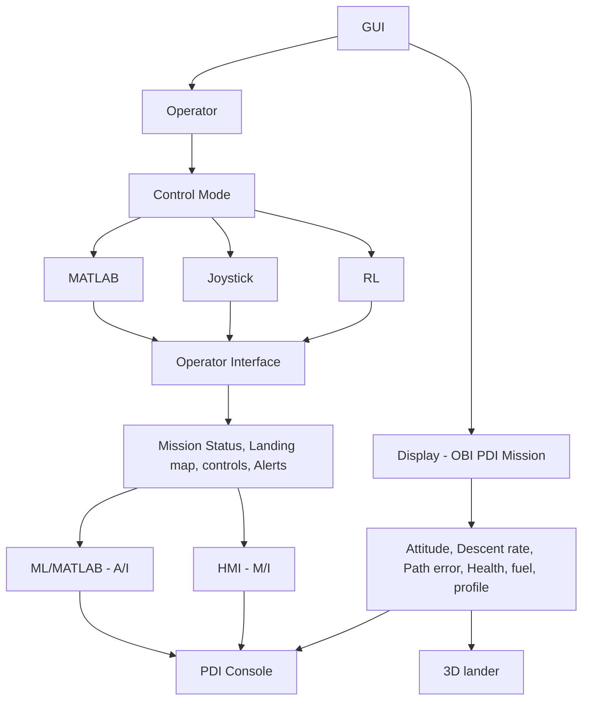

# OBI PDI Simulator 

## *Screen A - PDI Console*
## *Screen B - 3D state + Telemetry* 

## Functional Segments

1. Vehicle Configuration 
2. PDI Profile (Powered Descent Initiation)
3. Sensor and state estimation 
4. Guidance, Navigation & Control (MATLAB code, Joystick, ML) - control config 
5. Propulsion & RCS Allocation (Engine control - 3 ME, 2 AE, 4RCS)
6. 6DOF Dynamics and Lunar Environment (Behavior state, terrain model)
7. GUI Visualization (PDI Console, 3D Lander)
8. External Control (controller input)

| Interface       | Purpose                                                                    |
| --------------- | -------------------------------------------------------------------------- |
| Vehicle Config  | Mass, dimensions, engines & RCS layout                                     |
| PDI Profile     | Phases, target conditions, boundary conditions, transaction & cutoff roles |
| Estimated State | Position, Velocity, Landing site distance                                  |
| Telemetry Frame | State, Fuel, Health and Event flags                                        |
| Terrain Model   | Surface elevation, slope obstacles, geometry, control                      |
|                 |                                                                            |

### Architecture and Stack 

| Layer              | Tools                               | Responsibility                                                        |
| ------------------ | ----------------------------------- | --------------------------------------------------------------------- |
| GUI Layer          | Python                              | Panels, controls, plots and alerts                                    |
| Telemetry Backend  | Python                              | Data validation and state estimation                                  |
| MATLAB Integration | Generated code                      | Controlled Guidance & Navigation                                      |
| Joystick Interface | SDL                                 | Command acquisition, callibration and input mapping                   |
| ML interface       | TensorRT                            | Hazard detection and Autonomous landing path and trajectory estimates |
| Visualization      | 3D visualization Engine <PyQtGraph> | Trajectory, telemetry, fuel and terrain display                       |
| Data storage       | SQLite                              | Timestamped telemetry, commands. faults and replay                    |

### Tests and Acceptance Criteria

1. Telemetry - units as specificied, timestamps, packet validation 
2. MATLAB - repeatable output for identical inputs
3. Joystick - Axis mapping 
4. ML Autonomy - verfied model version, rejection of invalid inputs
5. Landing site  - canditate sites, ground math and lander selection/verification 
6. Mode switch & Mission replay - no overlapping command, recorded telemetry command and state transition
7. GUI Verification - boundary conditions, orientation, phase 

## Modules and Functions 

### Mission manager 
- initialize_mission()
- mission_config()
- pdi_sequenceid()
- pause/reset_mission()
- timestamp()

### Vehicle Manager
- vehicle_config()
- health(), attitude(), velocity()
- fuel_availability()
- raise_fault_alert()
- pdi_profile()

### Site Manager 
- targe_site()
- landing_profile()
- descent_phase()
- terrain_model()
- behavior_state()

### Control Manager
- control_config()
- source-mode()
	- load_matlabmodel
	- connect_joystick
	- load_mlmodel
- controller_input()
- trajectory_path()

### Navigation Manager
- behavior_state
- estimated_state
- engine_control
- navigation_state
- descent_rate
- estimate_touchdownState()
- trajectory_deviation

### Display manager & Data
- 3D_frame
- telemetry_frame
- dual_screen
	- pdi profile_screen
	- 3Dstate_telemetry screen
- record_telemetry
- record_commands
- validation_status
- log_events
- replay_descent
- export_mission_report